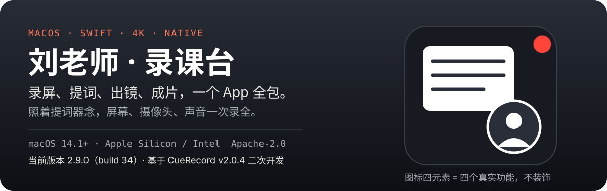

<p align="center">
  
</p>

# 刘老师 · 录课台 · macOS 录屏提词器

**一个软件全包高清录屏 + 摄像头画中画 + 麦克风 / 系统音频 + 内置提词器 + 4K 导出。** 专为录教程、录课、产品演示和口播视频打造。当前版本 **2.9.0（build 34）**，以 Xcode 工程为准。

[]()
[](https://www.swift.org/)
[](LICENSE)

录一条像样的教程视频，通常要拼三件工具：录屏软件录画面、提词器 App 照着稿子念、摄像头小窗单独开——录完还要对轨、合成，来回折腾。**录课台把这四件事装进一个原生 macOS App**：选好录制区域、打开提词器照着念，屏幕、摄像头、麦克风和系统声音一次录全，直接导出成片。

**适合谁**：录网课 / 教程的知识创作者、做产品演示和 SaaS walkthrough 的开发者与创始人、录口播和演示稿的演讲者——所有「要对着稿子录屏」的人。

> 接手维护或排查问题，先读 [HANDOVER.md](HANDOVER.md)：环境、代码地图、踩过的坑、调试命令都在里面。

## 核心功能

| 功能 | 说明 |
|---|---|
| 🎬 高清录屏 | 原生 Swift 实现，全屏 / 窗口 / 自选区域录制，支持多显示器（含外接屏） |
| 🪟 摄像头画中画 | 可选摄像头 overlay，预览窗可拖动，和屏幕内容一次合成 |
| 🎙️ 双路音频 | 麦克风 + 系统音频同时录制，最终成片为单轨混合音频，不用后期对轨 |
| 📜 内置提词器 | 可调行数、跟读滚动；录的时候照着念，不用背稿、不用另开提词器 |
| 🤖 AI 气口断句 | 接 OpenAI 兼容模型，自动给提词稿加自然断句（AI Breath Cuts） |
| 📊 PPT 稿导入 | PowerPoint / PPTX 演讲者备注一键导入为提词稿 |
| 🖥️ 4K 导出 | 导出分辨率预设最高 4K，选之前就显示预期输出尺寸 |
| 🗂️ 素材归档 | 原始素材统一收在项目目录的 `raw_data/`，成片留在项目根目录，不丢不乱 |
| 🗣️ 本地语音识别 | 内置本地 ASR 模型资产（Git LFS 管理），语音引导提词不依赖云端 |

## 快速开始

### 本地自用构建（最快，不需要开发者账号）

只想自己装上用，走 ad-hoc 签名即可，不需要 Apple Developer 账号：

```bash
git lfs install
git clone https://github.com/lhg-projects/lls-studio.git
cd lls-studio
git lfs pull
scripts/build-local.sh --install     # 构建并装到 ~/Applications/CueRecord.app
```

脚本会先校验 Xcode 和 Git LFS 资产（缺少模型/原生库时直接报错，不会编出一个跑不起来的包），再用 `CODE_SIGN_IDENTITY=-` 构建 Release，`--install` 会把产物拷到 `~/Applications`。

两点注意：

- 本仓库的 Bundle ID 是 `com.liulaoshi.llsstudio`，与上游官方包 CueRecord（`com.nolanlai.cuerecord`）**是两个独立 App**：可以和上游版本共存，但权限授权、偏好设置、Vault 路径都是各自独立的一套，首次启动要重新选 Vault 并重新授权。
- ad-hoc 签名每次重新编译后 CDHash 会变，macOS 会把屏幕录制等权限视为新 App，需要到「系统设置 → 隐私与安全性」里重新勾选。

### 源码构建

需要 **Xcode 16 或更高**（推荐最新 Xcode 26）——`xcodebuild` 只随 Xcode 提供，单独装 Command Line Tools 不够。

本仓库用 Git LFS 管理内置模型和原生库（约 370 MB），先装 Git LFS 再拉代码：

```bash
git lfs install
git clone https://github.com/lhg-projects/lls-studio.git
cd lls-studio
git lfs pull
```

构建本地调试版：

```bash
xcodebuild \
  -project CueRecord.xcodeproj \
  -scheme CueRecord \
  -configuration Debug \
  -destination 'platform=macOS' \
  build
```

跑录制核心的专项检查（40 个测试函数，见 `Tests/RecordingCoreTests/main.swift`）：

```bash
scripts/run-recording-core-tests.sh
```

### 预编译包

本仓库暂不提供签名安装包。上游提供已签名并公证的 v2.0.4 DMG，可在 [nolangz/CueRecord Releases](https://github.com/nolangz/CueRecord/releases) 下载；本仓库与上游 v2.0.4 代码一致，装上游包等于先体验同一版本。

## 系统要求

- macOS 14.1 或更高
- Apple Silicon 或 Intel Mac

## 权限说明

录制时按需申请 macOS 标准隐私权限，可在「系统设置 → 隐私与安全性」里管理：

- **屏幕录制**：录制所选显示器 / 窗口 / 区域，必须
- **麦克风**：录人声或使用语音引导提词时需要
- **摄像头**：开启摄像头画中画时需要
- **系统音频**：开启系统音频录制时需要

## 发布构建

`build.sh` 生成通用（Universal）App、签名、打包 DMG 并提交 Apple 公证。签名身份走环境变量，换成你自己的 Developer ID 即可：

```bash
TEAM_ID=<你的 Team ID>
SIGN_IDENTITY='Developer ID Application: <你的名字> (<Team ID>)'
NOTARY_PROFILE=<你的 notarytool keychain profile>
./build.sh
```

产物输出到 `build/release/CueRecord.dmg`。前置条件：Xcode 命令行工具、本机 Keychain 里装好 Developer ID 证书、Git LFS 资产已拉全。

## 项目结构

```text
CueRecord/                App 源码
CueRecord/Recording/      录制管线、界面、区域选择、指标、导出组织
Tests/RecordingCoreTests/ 录制核心行为的命令行专项检查
Vendor/                   Git LFS 管理的原生库与本地 ASR 模型资产
build.sh                  签名 + 公证的发布 DMG 构建脚本
```

## 与上游的关系

- 本项目 fork 自 [nolangz/CueRecord](https://github.com/nolangz/CueRecord) v2.0.4，依 **Apache License 2.0** 二次开发；许可证原文见 [LICENSE](LICENSE)，上游版权声明保留。
- 其中**提词器部分源自 [f/textream](https://github.com/f/textream)**（上游 Credits 已注明，此处沿袭标注）。
- 本次整改范围：README 与项目元信息已按自有项目规范重写，去掉上游作者的个人品牌内容。
- 代码在上游 v2.0.4 基础上的改动见下方「本仓库改动记录」，逐条可回归。
- 这是一个已发布的成熟项目，改动遵循上游 `AGENTS.md` 的约定：改动保持小而聚焦，每处改动测试受影响的区域后再算完成。

## 本仓库改动记录

> 当前版本 2.9.0（build 34，以 Xcode 工程为准）。下方记录截至 v2.2.1，v2.3.0–2.9.0 的版本记录尚未写入 README，待补——此处不编造。

### v2.2.1（权限修复 + 浮窗背景三档 + 启动崩溃修复）

- **修复「授权了还一直要授权」**：ad-hoc 签名的代码要求原本是自身 cdhash，每次重新构建都变，macOS 会把新包当成另一个应用，已有的屏幕录制/摄像头/麦克风授权全部失效。现在构建脚本会重签并固定代码要求为 bundle id，授权一次长期有效。
- **修复摄像头打不开**：Release 构建此前用 `CODE_SIGNING_REQUIRED=NO`，entitlements 从没真正签进包，hardened runtime 下系统直接抑制摄像头弹窗。现在正常签名并带上 camera / audio-input / disable-library-validation。
- **修复摄像头窗一直黑着**：系统状态是 notDetermined 时应用只查不请求，永远不会弹窗。现在首次使用会主动请求授权。
- 麦克风授权说明改为中文。
- 提词器浮窗背景从「透明开关」升级为三档：**实心 / 虚化 / 全透明**。全透明模式不画底板、不画毛玻璃，只画文字，并在文字上叠一圈暗影，保证浅色文档背景上仍然可读。
- 修复一个启动即崩的缺陷：本地化词条表里 `Background` 键重复，Swift 字典字面量重复 key 会在运行时 trap。已去重，并加回归测试 `LocalizationDictionaryHasNoDuplicateKeys`。
- 版本号 2.2.0（build 8）。

### v2.2.0（品牌化）

- 产品改名 **刘老师 · 录课台**：`PRODUCT_NAME=LLSStudio`（产物 `LLSStudio.app`），显示名走 `CFBundleDisplayName`，Finder / Dock / 菜单栏 / 关于页统一。
- 换新图标：石墨黑方底 + 白色课件卡（三行讲稿）+ 圆形出镜窗（人像）+ 录制红点；切图覆盖 16–1024 全尺寸，叙事见 [BRAND.md](BRAND.md)。
- Bundle ID 改为 `com.liulaoshi.llsstudio`，与上游包共存；首次启动需重新选 Vault、重新授权。
- 系统权限弹窗文案、文档类型名、更新检查与帮助链接改为自有身份。
- 内部标识保持不变：`.cuerecord` 元数据目录、`cuerecord://` scheme、Keychain service（`com.nolanlai.*`）、UTI `com.nolanlai.cuerecord.document`——目的是让已有 Vault 和已存 API key 继续可用。

### v2.1.0

**修复：停止录制后成片经常不生成（只剩屏幕轨 + 摄像头轨两个文件）**

根因是「录制结束后的剪辑导出窗口」用了全局布尔 + 单例窗口来判重，连续录第二、三条 take 时会被上一条残留的窗口挡掉，导出回调也没有任何提示：

- `RecordingEditorWindow.show` 在窗口已存在时直接 `return`，不重新绑定新 take —— 点导出会导出上一条。
- 该判重布尔在旧窗口未关闭时一直为真，导致后续 take 的编辑窗口整个不弹。
- `RecordingController.renderCapturedRecording` 在导出进行中静默 `return`，请求直接丢失。

改法（`RecordingEditorPresentation` + 三处调用点）：编辑窗口改为按 take 路径判定、`show` 复用窗口时重建绑定、导出请求改为排队执行而不丢弃、开始录制时先收起上一条残留的编辑窗口。

**构建：Xcode 16.4 下的一个必要修正**

`RecordingPreviewBarWindow` 没有标 `@MainActor`，却直接读 `RecordingController`（`@MainActor` 类）的 `currentRecordingInterfaceFrame`。Swift 6.1（Xcode 16.4）把这个隔离违规当错误处理，Release 构建直接失败——上游 2.0.4 的这个文件在本仓库未改动过，属于既有问题，不是本次修复引入的。加一行 `@MainActor` 即可，调用点全部在 `ContentView`（主线程）内。

**元信息与身份**

- Bundle ID 改为 `com.lhg.cuerecord`；签名身份、Developer Team 改为本机/自有（不再依赖上游证书）。
- 更新检查指向本仓库；帮助菜单链接、关于页署名改为本仓库与上游归属说明。
- 版本号 2.1.0（build 7）。

仍与上游共用的标识（故意保留，改了会打不开已有项目或丢失已保存的配置）：`cuerecord://` URL scheme、`.cuerecord` 项目元数据目录、`cuerecord/takeone/cueshot` 文档扩展名、`com.nolanlai.cuerecord.document` UTI、Keychain service `com.nolanlai.cuerecord.ai-provider`。
